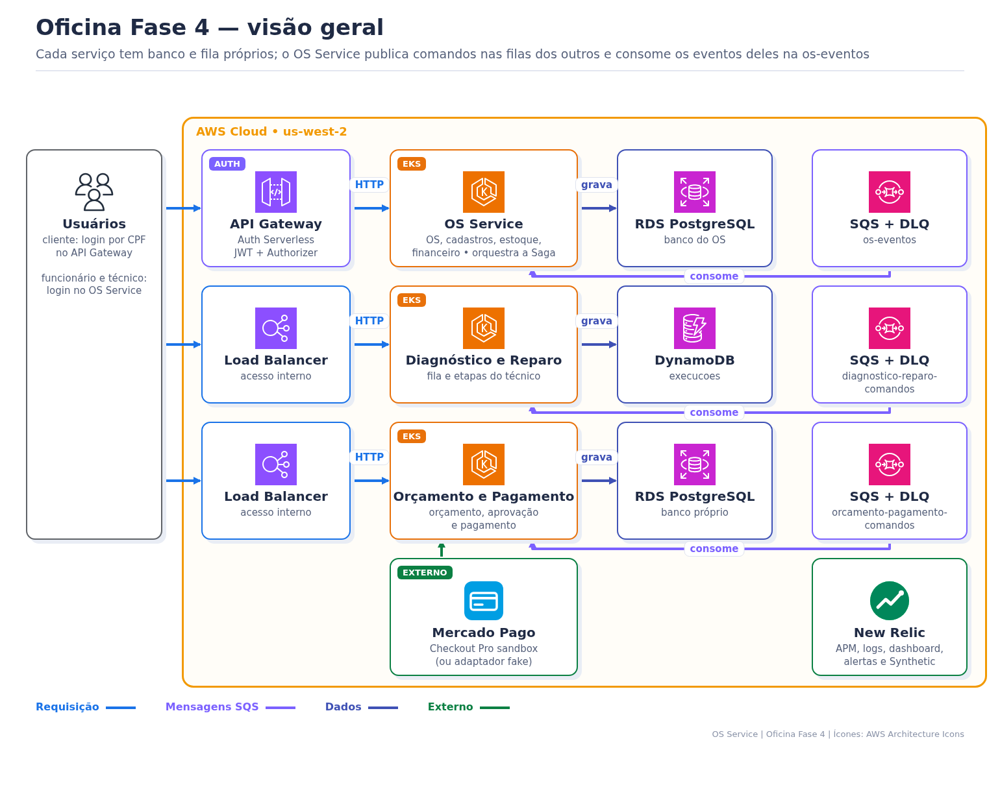

# Evidências de Atendimento aos Requisitos Obrigatórios — Oficina Fase 4

Este documento centraliza, de forma sucinta e objetiva, as evidências de atendimento aos requisitos obrigatórios do Tech Challenge — Oficina Fase 4. Cada seção segue a ordem do enunciado e apresenta os **arquivos técnicos** da implementação e as **evidências de execução** (runs do GitHub Actions, prints e vídeos).

## Índice

- [Projetos da solução contidos na estrutura de 6 repositórios](#projetos-da-solução-contidos-na-estrutura-de-6-repositórios)
- [1. Separação em microsserviços](#1-separação-em-microsserviços)
- [2. Banco de dados próprio: SQL e NoSQL](#2-banco-de-dados-próprio-sql-e-nosql)
- [3. Comunicação entre microsserviços](#3-comunicação-entre-microsserviços)
- [4. Saga Pattern](#4-saga-pattern)
- [5. Testes e qualidade](#5-testes-e-qualidade)
- [6. CI/CD automatizado](#6-cicd-automatizado)
- [7. Governança de branches](#7-governança-de-branches)
- [8. Infraestrutura com Terraform e Kubernetes](#8-infraestrutura-com-terraform-e-kubernetes)
- [9. Autenticação Serverless e API Gateway](#9-autenticação-serverless-e-api-gateway)
- [10. Monitoramento e rastreamento dos fluxos distribuídos](#10-monitoramento-e-rastreamento-dos-fluxos-distribuídos)
- [11. Documentação arquitetural](#11-documentação-arquitetural)
- [12. Entregáveis da Fase 4](#12-entregáveis-da-fase-4)
- [13. Justificativa da divisão e das tecnologias](#13-justificativa-da-divisão-e-das-tecnologias)
- [14. Documentação central e fechamento da entrega](#14-documentação-central-e-fechamento-da-entrega)

## Projetos da solução contidos na estrutura de 6 repositórios

| Projeto | Repositório | Papel | Banco |
|---|---|---|---|
| OS Service | [fiap-tc-fase4-oficina-os-service](https://github.com/tiagomiele/fiap-tc-fase4-oficina-os-service) | Abertura, status, histórico e consulta da OS; orquestrador da Saga; documentação central | RDS PostgreSQL |
| Orçamento e Pagamento | [fiap-tc-fase4-oficina-orcamento-pagamento-service](https://github.com/tiagomiele/fiap-tc-fase4-oficina-orcamento-pagamento-service) | Orçamento, aprovação e pagamento com Mercado Pago | RDS PostgreSQL |
| Diagnóstico e Reparo | [fiap-tc-fase4-oficina-diagnostico-reparo-service](https://github.com/tiagomiele/fiap-tc-fase4-oficina-diagnostico-reparo-service) | Fila do técnico, diagnóstico e reparo | DynamoDB |
| Auth Serverless | [fiap-tc-fase4-oficina-auth-serverless](https://github.com/tiagomiele/fiap-tc-fase4-oficina-auth-serverless) | Login do cliente por CPF, JWT, Lambda Authorizer e API Gateway | nenhum (consulta o OS por REST) |
| Database Infra | [fiap-tc-fase4-oficina-database-infra](https://github.com/tiagomiele/fiap-tc-fase4-oficina-database-infra) | Terraform dos bancos e das filas SQS, com uma pasta e um workspace por serviço | — |
| Kubernetes Infra | [fiap-tc-fase4-oficina-kubernetes-infra](https://github.com/tiagomiele/fiap-tc-fase4-oficina-kubernetes-infra) | Terraform da VPC, do EKS, dos add-ons e do New Relic | — |

## 1. Separação em microsserviços

O backend da Fase 3 foi dividido em 3 microsserviços Spring Boot independentes. Cada um tem repositório, `Dockerfile`, manifestos `k8s/`, pipeline, namespace no EKS, LoadBalancer e banco de dados próprios.

### Arquivos técnicos da separação em microsserviços

Os links abaixo comprovam onde cada responsabilidade exigida pelo enunciado foi implementada.

| Responsabilidade do enunciado | Serviço | Implementação |
|---|---|---|
| Abertura da OS | OS Service | [`AdministrativoOficinaController`](https://github.com/tiagomiele/fiap-tc-fase4-oficina-os-service/blob/main/src/main/java/br/com/oficina/adapter/controller/AdministrativoOficinaController.java) |
| Atualização de status | OS Service (pela Saga) | [`SagaOrdemServicoServiceImpl`](https://github.com/tiagomiele/fiap-tc-fase4-oficina-os-service/blob/main/src/main/java/br/com/oficina/usecase/SagaOrdemServicoServiceImpl.java) |
| Consulta de status e histórico | OS Service | [`ClienteOficinaController`](https://github.com/tiagomiele/fiap-tc-fase4-oficina-os-service/blob/main/src/main/java/br/com/oficina/adapter/controller/ClienteOficinaController.java) e tabela `historico_status_ordem_servico` |
| Geração e envio do orçamento para aprovação | Orçamento e Pagamento | [`OrcamentoController`](https://github.com/tiagomiele/fiap-tc-fase4-oficina-orcamento-pagamento-service/blob/main/src/main/java/br/com/oficina/orcamentopagamento/adapter/controller/OrcamentoController.java) e comando `GERAR_ORCAMENTO` em [`SqsComandosConsumidor`](https://github.com/tiagomiele/fiap-tc-fase4-oficina-orcamento-pagamento-service/blob/main/src/main/java/br/com/oficina/orcamentopagamento/adapter/messaging/SqsComandosConsumidor.java) |
| Registro e verificação de pagamentos | Orçamento e Pagamento | [`PagamentoController`](https://github.com/tiagomiele/fiap-tc-fase4-oficina-orcamento-pagamento-service/blob/main/src/main/java/br/com/oficina/orcamentopagamento/adapter/controller/PagamentoController.java) e [`MercadoPagoWebhookController`](https://github.com/tiagomiele/fiap-tc-fase4-oficina-orcamento-pagamento-service/blob/main/src/main/java/br/com/oficina/orcamentopagamento/adapter/controller/MercadoPagoWebhookController.java) |
| Integração com o Mercado Pago | Orçamento e Pagamento | [`MercadoPagoPagamentoGateway`](https://github.com/tiagomiele/fiap-tc-fase4-oficina-orcamento-pagamento-service/blob/main/src/main/java/br/com/oficina/orcamentopagamento/adapter/payment/MercadoPagoPagamentoGateway.java) (Checkout Pro sandbox) e [README, seção 6](https://github.com/tiagomiele/fiap-tc-fase4-oficina-orcamento-pagamento-service/blob/main/README.md#6-integração-com-o-mercado-pago) |
| Atualização do status da OS após pagamento | Orçamento e Pagamento → OS | evento `PAGAMENTO_CONFIRMADO` → OS `PAGA` ([contrato das mensagens](docs-fase4/saga/contrato-mensagens.md)) |
| Gerenciar a fila de execução da OS | Diagnóstico e Reparo | [`ExecucaoController`](https://github.com/tiagomiele/fiap-tc-fase4-oficina-diagnostico-reparo-service/blob/main/src/main/java/br/com/oficina/diagnosticoreparo/adapter/controller/ExecucaoController.java) (`GET /execucoes/fila`) |
| Atualizar status durante diagnóstico e reparo | Diagnóstico e Reparo | [`ExecucaoService`](https://github.com/tiagomiele/fiap-tc-fase4-oficina-diagnostico-reparo-service/blob/main/src/main/java/br/com/oficina/diagnosticoreparo/usecase/ExecucaoService.java) |
| Comunicar a finalização ao OS Service | Diagnóstico e Reparo → OS | eventos `DIAGNOSTICO_CONCLUIDO` e `REPARO_CONCLUIDO` na fila `os-eventos` |

### Evidências de execução da separação em microsserviços

- [EKS — Implantações dos 3 serviços, um namespace por serviço](docs-fase4/evidencias/01-microsservicos/) — *incluir print*.
- [Swagger de cada serviço em execução](docs-fase4/evidencias/01-microsservicos/) — *incluir prints*.
- **Pagamento validado em produção com o Mercado Pago Sandbox:** OS `OS-112026-000001`, pagamento `APROVADO`, provedor `mercadopago`, OS em `PAGA`. Roteiro reproduzível: [`scripts/pagamento-mercadopago.ps1`](scripts/pagamento-mercadopago.ps1).

## 2. Banco de dados próprio: SQL e NoSQL

Cada microsserviço tem banco próprio. A solução usa 2 bancos relacionais (SQL) e 1 não relacional (NoSQL), como exige o enunciado.

### Arquivos técnicos dos bancos de dados

| Serviço | Banco | Tipo | Implementação |
|---|---|---|---|
| OS Service | RDS PostgreSQL 16 `oficina-<env>-os-db` | **SQL** | [`os/main.tf`](https://github.com/tiagomiele/fiap-tc-fase4-oficina-database-infra/blob/main/os/main.tf) e [migrations](https://github.com/tiagomiele/fiap-tc-fase4-oficina-os-service/tree/main/src/main/resources/db/migration) |
| Orçamento e Pagamento | RDS PostgreSQL 16 `oficina-<env>-orcamento-pagamento-db` | **SQL** | [`orcamento-pagamento/`](https://github.com/tiagomiele/fiap-tc-fase4-oficina-database-infra/tree/main/orcamento-pagamento) e [`V1__orcamento_pagamento.sql`](https://github.com/tiagomiele/fiap-tc-fase4-oficina-orcamento-pagamento-service/blob/main/src/main/resources/db/migration/V1__orcamento_pagamento.sql) |
| Diagnóstico e Reparo | DynamoDB `oficina-<env>-execucoes` | **NoSQL** | [`diagnostico-reparo/`](https://github.com/tiagomiele/fiap-tc-fase4-oficina-database-infra/tree/main/diagnostico-reparo), [`DynamoDbExecucaoRepository`](https://github.com/tiagomiele/fiap-tc-fase4-oficina-diagnostico-reparo-service/blob/main/src/main/java/br/com/oficina/diagnosticoreparo/adapter/persistence/DynamoDbExecucaoRepository.java) e [modelo de dados](https://github.com/tiagomiele/fiap-tc-fase4-oficina-diagnostico-reparo-service/blob/main/docs/modelo-dados-dynamodb.md) |

**Infraestrutura por serviço:** o Terraform dos bancos fica no Database Infra, mas em **uma pasta por serviço**, cada uma com state, workspace HCP (`oficina-fase4-db-<serviço>-<env>`) e workflow próprios. Um deploy não depende do outro.

Como ver os dados gravados (DBeaver/`psql` por túnel, Console do DynamoDB, SQS e DLQ): [Database Infra, seção 6](https://github.com/tiagomiele/fiap-tc-fase4-oficina-database-infra/blob/main/README.md#6-bancos-de-dados-e-como-ver-os-dados).

### Evidências de execução do provisionamento

| Componente | Homologação | Produção |
|---|---|---|
| Database OS (RDS + SQS) | [Run 43610368364](https://github.com/tiagomiele/fiap-tc-fase4-oficina-database-infra/actions/runs/43610368364) | [Run 43732234220](https://github.com/tiagomiele/fiap-tc-fase4-oficina-database-infra/actions/runs/43732234220) |
| Database Orçamento e Pagamento (RDS + SQS) | [Run 43611579716](https://github.com/tiagomiele/fiap-tc-fase4-oficina-database-infra/actions/runs/43611579716) | [Run 43733431259](https://github.com/tiagomiele/fiap-tc-fase4-oficina-database-infra/actions/runs/43733431259) |
| Database Diagnóstico e Reparo (DynamoDB + SQS) | [Run 43612731260](https://github.com/tiagomiele/fiap-tc-fase4-oficina-database-infra/actions/runs/43612731260) | [Run 43734678178](https://github.com/tiagomiele/fiap-tc-fase4-oficina-database-infra/actions/runs/43734678178) |

### Evidências complementares

- [Aurora and RDS — os 2 bancos `Disponível`](docs-fase4/evidencias/02-banco-de-dados/) — *incluir print*.
- [DynamoDB — item da execução de uma OS](docs-fase4/evidencias/02-banco-de-dados/) — *incluir print*.

## 3. Comunicação entre microsserviços

A comunicação entre os 3 serviços é assíncrona, por Amazon SQS com DLQ. O REST síncrono fica para a entrada dos usuários e para a integração com o Mercado Pago. **Nenhum serviço acessa o banco de outro.**

### Arquivos técnicos da comunicação

| Estratégia | Uso | Implementação |
|---|---|---|
| REST síncrono | Funcionário e técnico chamam o LoadBalancer de cada serviço; o cliente chama pelo API Gateway com JWT | [`apigateway.tf`](https://github.com/tiagomiele/fiap-tc-fase4-oficina-auth-serverless/blob/main/apigateway.tf) e controllers de cada serviço |
| REST síncrono externo | Orçamento e Pagamento → Mercado Pago; Mercado Pago → webhook | [`MercadoPagoPagamentoGateway`](https://github.com/tiagomiele/fiap-tc-fase4-oficina-orcamento-pagamento-service/blob/main/src/main/java/br/com/oficina/orcamentopagamento/adapter/payment/MercadoPagoPagamentoGateway.java) |
| Mensageria assíncrona (**Amazon SQS** + DLQ) | Comandos e eventos da Saga entre os 3 serviços | [`SqsMensageriaGateway`](https://github.com/tiagomiele/fiap-tc-fase4-oficina-os-service/blob/main/src/main/java/br/com/oficina/adapter/messaging/SqsMensageriaGateway.java), [`SqsEventosConsumidor`](https://github.com/tiagomiele/fiap-tc-fase4-oficina-os-service/blob/main/src/main/java/br/com/oficina/adapter/messaging/SqsEventosConsumidor.java) e módulo [`sqs-com-dlq`](https://github.com/tiagomiele/fiap-tc-fase4-oficina-database-infra/tree/main/modules/sqs-com-dlq) |

| Fila | Consumidor | Publicadores |
|---|---|---|
| `oficina-<env>-os-eventos` | OS Service | Diagnóstico e Reparo, Orçamento e Pagamento |
| `oficina-<env>-diagnostico-reparo-comandos` | Diagnóstico e Reparo | OS Service |
| `oficina-<env>-orcamento-pagamento-comandos` | Orçamento e Pagamento | OS Service |

Cada fila tem uma DLQ, para onde a mensagem vai depois de 5 tentativas sem sucesso.

**Isolamento dos bancos:** cada serviço recebe só as credenciais do próprio banco. Os dados que um serviço precisa do outro chegam no `payload` das mensagens. A Lambda de login também não acessa o banco do OS: ela chama a rota interna `POST /interno/clientes/autenticacao` do OS Service ([`InternoClienteController`](https://github.com/tiagomiele/fiap-tc-fase4-oficina-os-service/blob/main/src/main/java/br/com/oficina/adapter/controller/InternoClienteController.java)).

### Evidências de execução da comunicação

- [SQS — as 6 filas (3 principais e 3 DLQs)](docs-fase4/evidencias/03-comunicacao/) — *incluir print*.
- [SQS — regra da DLQ, com Número máximo de recebimentos = 5](docs-fase4/evidencias/03-comunicacao/) — *incluir print*.
- [CloudWatch — `NumberOfMessagesSent` das 3 filas na ordem da Saga](docs-fase4/evidencias/03-comunicacao/) — *incluir print*.

## 4. Saga Pattern

**Estratégia: Saga orquestrada**, com o OS Service como orquestrador central.

### Justificativa da escolha

- O fluxo da OS é **sequencial e tem um dono natural**: diagnóstico → orçamento → aprovação → reparo → pagamento. O OS Service já guardava o status da OS na Fase 3, e esse status virou o estado da Saga, sem tabela extra.
- A regra de "qual é o próximo passo" e "o que desfazer" fica num lugar só. Os outros serviços só obedecem comandos e respondem eventos.
- Na coreografia, cada serviço teria que conhecer os eventos dos outros, e as compensações ficariam espalhadas.
- O rastreamento fica simples: o `correlationId` nasce na abertura da OS, e o histórico da OS mostra a Saga inteira.

### Arquivos técnicos da Saga

- [Orquestrador — `SagaOrdemServicoServiceImpl`](https://github.com/tiagomiele/fiap-tc-fase4-oficina-os-service/blob/main/src/main/java/br/com/oficina/usecase/SagaOrdemServicoServiceImpl.java)
- [Documentação da Saga e como validar](docs-fase4/saga/README.md)
- [Contrato das mensagens](docs-fase4/saga/contrato-mensagens.md)
- [Diagrama do fluxo](docs-fase4/assets/saga-fluxo.png) e [diagrama dos comandos e eventos](docs-fase4/assets/saga-orquestrada-eventos-fase4.png)

| Passo | Mensagem | De → Para | Status da OS |
|---|---|---|---|
| 1 | `INICIAR_DIAGNOSTICO` | OS → Diagnóstico | `RECEBIDA` |
| 2 | `DIAGNOSTICO_INICIADO` / `DIAGNOSTICO_CONCLUIDO` | Diagnóstico → OS | `EM_DIAGNOSTICO` → `AGUARDANDO_APROVACAO` |
| 3 | `GERAR_ORCAMENTO` | OS → Orçamento | `AGUARDANDO_APROVACAO` |
| 4 | `ORCAMENTO_APROVADO` | Orçamento → OS (baixa o estoque) | `EM_EXECUCAO` |
| 5 | `INICIAR_REPARO` | OS → Diagnóstico e Reparo | `EM_EXECUCAO` |
| 6 | `REPARO_CONCLUIDO` | Reparo → OS | `AGUARDANDO_PAGAMENTO` |
| 7 | `SOLICITAR_PAGAMENTO` | OS → Pagamento | `AGUARDANDO_PAGAMENTO` |
| 8 | `PAGAMENTO_CONFIRMADO` | Pagamento → OS | `PAGA` → `ENTREGUE` |

### Rollback e compensação

| Falha | Compensação |
|---|---|
| Estoque insuficiente na aprovação | OS `CANCELADA`; o OS envia `CANCELAR_ORCAMENTO` e `CANCELAR_EXECUCAO` |
| Cliente rejeita e cancela | OS `CANCELADA`; o OS envia `CANCELAR_EXECUCAO` |
| Cliente rejeita para refazer | OS volta para `EM_DIAGNOSTICO`, com novo `INICIAR_DIAGNOSTICO` |
| Pagamento recusado | OS fica em `AGUARDANDO_PAGAMENTO`; o cliente tenta de novo (`nova-tentativa`) |
| Erro técnico ao processar | transação desfeita; a mensagem volta à fila e, depois de 5 tentativas, vai para a DLQ |
| Mensagem repetida ou fora de ordem | ignorada, por idempotência no `messageId` e checagem do status atual |

### Evidências de execução da Saga

| Contexto | Tipo | Execução |
|---|---|---|
| `homolog` | BDD da Saga (fluxo feliz e 4 compensações) | [Run 43507318947](https://github.com/tiagomiele/fiap-tc-fase4-oficina-os-service/actions/runs/43507318947) |
| `main` | BDD da Saga (fluxo feliz e 4 compensações) | [Run 43508212391](https://github.com/tiagomiele/fiap-tc-fase4-oficina-os-service/actions/runs/43508212391) |
| Homologação | Validação funcional E2E (Postman/Newman) | [Run 43101361602](https://github.com/tiagomiele/fiap-tc-fase4-oficina-os-service/actions/runs/43101361602) |
| Produção | Validação funcional E2E (Postman/Newman) | [Run 43325386467](https://github.com/tiagomiele/fiap-tc-fase4-oficina-os-service/actions/runs/43325386467) |

### Evidências complementares

- [Swagger — fluxo feliz com pagamento no Mercado Pago, etapa por etapa](docs-fase4/evidencias/04-saga/) — *incluir prints*.
- [Swagger — compensações (rejeição, estoque insuficiente e pagamento recusado)](docs-fase4/evidencias/04-saga/) — *incluir prints*.
- [Histórico da OS e logs da Saga por `correlationId`](docs-fase4/evidencias/04-saga/) — *incluir prints*.

## 5. Testes e qualidade

Os 3 microsserviços têm testes unitários, cobertura mínima de 80% validada no build e análise de qualidade no SonarCloud. O fluxo completo da Saga é testado com BDD.

### Arquivos técnicos dos testes

| Exigência | Atendimento | Implementação |
|---|---|---|
| Testes unitários em todos os microsserviços | JUnit 5 + Mockito em OS, Orçamento e Pagamento, Diagnóstico e Reparo e Auth | pasta `src/test` de cada repositório |
| Pelo menos um fluxo completo com BDD | Cucumber em português com os **3 serviços reais**, 2 PostgreSQL e LocalStack (SQS e DynamoDB): fluxo feliz e 4 compensações | [`saga.feature`](bdd/src/test/resources/features/saga.feature) e [`bdd.yml`](.github/workflows/bdd.yml) |
| Cobertura mínima de 80% por serviço | JaCoCo com `minimum 0.80` no `pom.xml`: o build falha abaixo disso | tabela abaixo |
| Qualidade do código no CI | SonarCloud com Quality Gate, Security scan e SBOM CycloneDX + Dependency-Track | job `SonarCloud` do `ci.yml` de cada serviço |
| Teste ponta a ponta no ambiente real | Collection Postman executada com Newman contra os 3 serviços e o API Gateway | [`e2e.yml`](.github/workflows/e2e.yml) e [collection](tests/postman/oficina-weeks4-5.postman_collection.json) |

### Evidências de cobertura e qualidade

| Serviço | Linhas | Instruções | Branches | Execução (artefato `jacoco-report`) | SonarCloud |
|---|---|---|---|---|---|
| OS Service | 84,4% | 83,3% | 71,3% | [Run 41484365373](https://github.com/tiagomiele/fiap-tc-fase4-oficina-os-service/actions/runs/41484365373) | [Quality Gate](https://sonarcloud.io/summary/overall?id=tiagomiele_fiap-tc-fase4-oficina-os-service&branch=homolog) |
| Orçamento e Pagamento | 99,0% | 99,4% | 93,9% | [Run 41473064053](https://github.com/tiagomiele/fiap-tc-fase4-oficina-orcamento-pagamento-service/actions/runs/41473064053) | [Quality Gate](https://sonarcloud.io/summary/overall?id=tiagomiele_fiap-tc-fase4-oficina-orcamento-pagamento-service&branch=homolog) |
| Diagnóstico e Reparo | 99,4% | 99,2% | 92,5% | [Run 41476675173](https://github.com/tiagomiele/fiap-tc-fase4-oficina-diagnostico-reparo-service/actions/runs/41476675173) | [Quality Gate](https://sonarcloud.io/summary/overall?id=tiagomiele_fiap-tc-fase4-oficina-diagnostico-reparo-service&branch=homolog) |

Os valores vêm do relatório JaCoCo do último CI verde em `homolog` (02/11/2026). O Quality Gate do SonarCloud está **PASSED** nesses runs. Cada README também traz a evidência de cobertura: [OS](README.md#evidência-de-cobertura-de-testes), [Orçamento e Pagamento](https://github.com/tiagomiele/fiap-tc-fase4-oficina-orcamento-pagamento-service/blob/main/README.md#evidência-de-cobertura-de-testes) e [Diagnóstico e Reparo](https://github.com/tiagomiele/fiap-tc-fase4-oficina-diagnostico-reparo-service/blob/main/README.md#evidência-de-cobertura-de-testes).

### Evidências complementares

- [SonarCloud — Quality Gate dos 3 serviços](docs-fase4/evidencias/05-testes-qualidade/) — *incluir prints*.
- [Relatório JaCoCo dos 3 serviços](docs-fase4/evidencias/05-testes-qualidade/) — *incluir prints*.

## 6. CI/CD automatizado

Cada microsserviço tem pipeline de CI/CD independente, no próprio repositório, com build, testes, verificação de qualidade e deploy automatizado no Kubernetes. A infraestrutura e o Auth também têm CI e deploy por Terraform.

### Arquivos técnicos de configuração dos workflows

| Projeto | Workflows configurados |
|---|---|
| OS Service | [CI](.github/workflows/ci.yml) · [CD](.github/workflows/cd.yml) · [Deploy](.github/workflows/deploy.yml) · [BDD](.github/workflows/bdd.yml) · [E2E](.github/workflows/e2e.yml) |
| Orçamento e Pagamento | [CI](https://github.com/tiagomiele/fiap-tc-fase4-oficina-orcamento-pagamento-service/blob/main/.github/workflows/ci.yml) · [CD](https://github.com/tiagomiele/fiap-tc-fase4-oficina-orcamento-pagamento-service/blob/main/.github/workflows/cd.yml) · [Deploy](https://github.com/tiagomiele/fiap-tc-fase4-oficina-orcamento-pagamento-service/blob/main/.github/workflows/deploy.yml) |
| Diagnóstico e Reparo | [CI](https://github.com/tiagomiele/fiap-tc-fase4-oficina-diagnostico-reparo-service/blob/main/.github/workflows/ci.yml) · [CD](https://github.com/tiagomiele/fiap-tc-fase4-oficina-diagnostico-reparo-service/blob/main/.github/workflows/cd.yml) · [Deploy](https://github.com/tiagomiele/fiap-tc-fase4-oficina-diagnostico-reparo-service/blob/main/.github/workflows/deploy.yml) |
| Auth | [CI](https://github.com/tiagomiele/fiap-tc-fase4-oficina-auth-serverless/blob/main/.github/workflows/ci.yml) · [Terraform Plan](https://github.com/tiagomiele/fiap-tc-fase4-oficina-auth-serverless/blob/main/.github/workflows/terraform-plan.yml) · [Terraform Deploy](https://github.com/tiagomiele/fiap-tc-fase4-oficina-auth-serverless/blob/main/.github/workflows/terraform-deploy.yml) |
| Database | [CI](https://github.com/tiagomiele/fiap-tc-fase4-oficina-database-infra/blob/main/.github/workflows/ci.yml) · [OS](https://github.com/tiagomiele/fiap-tc-fase4-oficina-database-infra/blob/main/.github/workflows/os.yml) · [Orçamento e Pagamento](https://github.com/tiagomiele/fiap-tc-fase4-oficina-database-infra/blob/main/.github/workflows/orcamento-pagamento.yml) · [Diagnóstico e Reparo](https://github.com/tiagomiele/fiap-tc-fase4-oficina-database-infra/blob/main/.github/workflows/diagnostico-reparo.yml) |
| Kubernetes | [CI](https://github.com/tiagomiele/fiap-tc-fase4-oficina-kubernetes-infra/blob/main/.github/workflows/ci.yml) · [Terraform Plan](https://github.com/tiagomiele/fiap-tc-fase4-oficina-kubernetes-infra/blob/main/.github/workflows/terraform-plan.yml) · [Deploy homolog](https://github.com/tiagomiele/fiap-tc-fase4-oficina-kubernetes-infra/blob/main/.github/workflows/deploy-homolog.yml) · [Deploy production](https://github.com/tiagomiele/fiap-tc-fase4-oficina-kubernetes-infra/blob/main/.github/workflows/deploy-production.yml) |

### Etapas da esteira dos microsserviços

| Etapa | Job | Quando roda |
|---|---|---|
| Build, testes e cobertura | `Build, test & coverage` (JaCoCo ≥ 80%) | todo push e todo PR |
| Qualidade e segurança | `SonarCloud`, `Security scan`, `SBOM (CycloneDX) + Dependency-Track` | todo push e todo PR |
| Validação antes do deploy | `Validate application` (testes de novo) | push em `homolog` ou `main` |
| Imagem | `Docker build & push (GHCR)` | depois da validação |
| Deploy no Kubernetes | `Deploy HOMOLOG` (push em `homolog`) ou `Deploy PRODUÇÃO` (push em `main`) | depois da imagem |

### Evidências de execução do CI/CD

| Projeto | CI `homolog` | Deploy homologação | CI `main` | Deploy produção |
|---|---|---|---|---|
| OS Service | [Run 43507319113](https://github.com/tiagomiele/fiap-tc-fase4-oficina-os-service/actions/runs/43507319113) | [Run 43614703425](https://github.com/tiagomiele/fiap-tc-fase4-oficina-os-service/actions/runs/43614703425) | [Run 43508212590](https://github.com/tiagomiele/fiap-tc-fase4-oficina-os-service/actions/runs/43508212590) | [Run 43737788323](https://github.com/tiagomiele/fiap-tc-fase4-oficina-os-service/actions/runs/43737788323) |
| Orçamento e Pagamento | [Run 43046450848](https://github.com/tiagomiele/fiap-tc-fase4-oficina-orcamento-pagamento-service/actions/runs/43046450848) | [Run 43640476466](https://github.com/tiagomiele/fiap-tc-fase4-oficina-orcamento-pagamento-service/actions/runs/43640476466) | [Run 43047871464](https://github.com/tiagomiele/fiap-tc-fase4-oficina-orcamento-pagamento-service/actions/runs/43047871464) | [Run 43489759299](https://github.com/tiagomiele/fiap-tc-fase4-oficina-orcamento-pagamento-service/actions/runs/43489759299) |
| Diagnóstico e Reparo | [Run 43038356507](https://github.com/tiagomiele/fiap-tc-fase4-oficina-diagnostico-reparo-service/actions/runs/43038356507) | [Run 43616496310](https://github.com/tiagomiele/fiap-tc-fase4-oficina-diagnostico-reparo-service/actions/runs/43616496310) | [Run 43038951152](https://github.com/tiagomiele/fiap-tc-fase4-oficina-diagnostico-reparo-service/actions/runs/43038951152) | [Run 43480574724](https://github.com/tiagomiele/fiap-tc-fase4-oficina-diagnostico-reparo-service/actions/runs/43480574724) |
| Auth | [Run 43032326577](https://github.com/tiagomiele/fiap-tc-fase4-oficina-auth-serverless/actions/runs/43032326577) | [Run 43637652897](https://github.com/tiagomiele/fiap-tc-fase4-oficina-auth-serverless/actions/runs/43637652897) | [Run 43032701618](https://github.com/tiagomiele/fiap-tc-fase4-oficina-auth-serverless/actions/runs/43032701618) | [Run 43735623612](https://github.com/tiagomiele/fiap-tc-fase4-oficina-auth-serverless/actions/runs/43735623612) |
| Database | [Run 43029381977](https://github.com/tiagomiele/fiap-tc-fase4-oficina-database-infra/actions/runs/43029381977) | ver [seção 2](#evidências-de-execução-do-provisionamento) | [Run 43029800311](https://github.com/tiagomiele/fiap-tc-fase4-oficina-database-infra/actions/runs/43029800311) | ver [seção 2](#evidências-de-execução-do-provisionamento) |
| Kubernetes | [Run 43027606288](https://github.com/tiagomiele/fiap-tc-fase4-oficina-kubernetes-infra/actions/runs/43027606288) | [Run 43638170090](https://github.com/tiagomiele/fiap-tc-fase4-oficina-kubernetes-infra/actions/runs/43638170090) | [Run 43027994762](https://github.com/tiagomiele/fiap-tc-fase4-oficina-kubernetes-infra/actions/runs/43027994762) | [Run 43730415946](https://github.com/tiagomiele/fiap-tc-fase4-oficina-kubernetes-infra/actions/runs/43730415946) |

Os runs do quadro foram concluídos com `success`.

### Evidências complementares

- [Promoção completa da esteira: PR para `homolog` → CD em homologação → PR `homolog` → `main` → CD em produção](docs-fase4/evidencias/06-cicd/) — *incluir prints*.

## 7. Governança de branches

As branches `homolog` e `main` dos 6 repositórios têm os rulesets `Proteção homolog` e `Proteção main` ativos. Eles exigem Pull Request e checks aprovados, e impedem push direto e force-push. A promoção para produção ocorre por Pull Request de `homolog` para `main`.

### Configuração técnica da proteção das branches

| Projeto | `homolog` | `main` |
|---|---|---|
| OS Service | [Ruleset de homologação](https://github.com/tiagomiele/fiap-tc-fase4-oficina-os-service/rules/27051486) | [Ruleset de produção](https://github.com/tiagomiele/fiap-tc-fase4-oficina-os-service/rules/27051481) |
| Orçamento e Pagamento | [Ruleset de homologação](https://github.com/tiagomiele/fiap-tc-fase4-oficina-orcamento-pagamento-service/rules/27051520) | [Ruleset de produção](https://github.com/tiagomiele/fiap-tc-fase4-oficina-orcamento-pagamento-service/rules/27051516) |
| Diagnóstico e Reparo | [Ruleset de homologação](https://github.com/tiagomiele/fiap-tc-fase4-oficina-diagnostico-reparo-service/rules/27051498) | [Ruleset de produção](https://github.com/tiagomiele/fiap-tc-fase4-oficina-diagnostico-reparo-service/rules/27051493) |
| Auth | [Ruleset de homologação](https://github.com/tiagomiele/fiap-tc-fase4-oficina-auth-serverless/rules/27051511) | [Ruleset de produção](https://github.com/tiagomiele/fiap-tc-fase4-oficina-auth-serverless/rules/27051508) |
| Database | [Ruleset de homologação](https://github.com/tiagomiele/fiap-tc-fase4-oficina-database-infra/rules/27051531) | [Ruleset de produção](https://github.com/tiagomiele/fiap-tc-fase4-oficina-database-infra/rules/27051525) |
| Kubernetes | [Ruleset de homologação](https://github.com/tiagomiele/fiap-tc-fase4-oficina-kubernetes-infra/rules/27051505) | [Ruleset de produção](https://github.com/tiagomiele/fiap-tc-fase4-oficina-kubernetes-infra/rules/27051502) |

Nos 3 microsserviços, os checks obrigatórios são `Repository validation`, `Build, test & coverage`, `SonarCloud`, `SBOM (CycloneDX) + Dependency-Track` e `Security scan`. Os rulesets são criados e sincronizados pelo [`scripts/configure-environment.ps1`](scripts/configure-environment.ps1).

### Evidências de execução da promoção para produção

| Projeto | Último Pull Request de promoção | Histórico de Pull Requests |
|---|---|---|
| OS Service | [PR #6 — `homolog` → `main`](https://github.com/tiagomiele/fiap-tc-fase4-oficina-os-service/pull/6) | [Histórico](https://github.com/tiagomiele/fiap-tc-fase4-oficina-os-service/pulls?q=is%3Apr) |
| Orçamento e Pagamento | [PR #2 — `homolog` → `main`](https://github.com/tiagomiele/fiap-tc-fase4-oficina-orcamento-pagamento-service/pull/2) | [Histórico](https://github.com/tiagomiele/fiap-tc-fase4-oficina-orcamento-pagamento-service/pulls?q=is%3Apr) |
| Diagnóstico e Reparo | [PR #2 — `homolog` → `main`](https://github.com/tiagomiele/fiap-tc-fase4-oficina-diagnostico-reparo-service/pull/2) | [Histórico](https://github.com/tiagomiele/fiap-tc-fase4-oficina-diagnostico-reparo-service/pulls?q=is%3Apr) |
| Auth | [PR #2 — `homolog` → `main`](https://github.com/tiagomiele/fiap-tc-fase4-oficina-auth-serverless/pull/2) | [Histórico](https://github.com/tiagomiele/fiap-tc-fase4-oficina-auth-serverless/pulls?q=is%3Apr) |
| Database | [PR #2 — `homolog` → `main`](https://github.com/tiagomiele/fiap-tc-fase4-oficina-database-infra/pull/2) | [Histórico](https://github.com/tiagomiele/fiap-tc-fase4-oficina-database-infra/pulls?q=is%3Apr) |
| Kubernetes | [PR #2 — `homolog` → `main`](https://github.com/tiagomiele/fiap-tc-fase4-oficina-kubernetes-infra/pull/2) | [Histórico](https://github.com/tiagomiele/fiap-tc-fase4-oficina-kubernetes-infra/pulls?q=is%3Apr) |

## 8. Infraestrutura com Terraform e Kubernetes

VPC, EKS, add-ons, bancos, filas SQS, API Gateway, Lambdas e New Relic são provisionados com Terraform no HCP Terraform, com workspaces separados por componente e ambiente. Os 3 microsserviços rodam no Amazon EKS, um namespace por serviço.

### Arquivos técnicos da infraestrutura como código

| Componente | Arquivo de implementação |
|---|---|
| Rede e EKS | [network.tf](https://github.com/tiagomiele/fiap-tc-fase4-oficina-kubernetes-infra/blob/main/network.tf) · [eks.tf](https://github.com/tiagomiele/fiap-tc-fase4-oficina-kubernetes-infra/blob/main/eks.tf) |
| Add-ons Kubernetes | [kubernetes](https://github.com/tiagomiele/fiap-tc-fase4-oficina-kubernetes-infra/tree/main/kubernetes) |
| Bancos e filas por serviço | [os](https://github.com/tiagomiele/fiap-tc-fase4-oficina-database-infra/tree/main/os) · [orcamento-pagamento](https://github.com/tiagomiele/fiap-tc-fase4-oficina-database-infra/tree/main/orcamento-pagamento) · [diagnostico-reparo](https://github.com/tiagomiele/fiap-tc-fase4-oficina-database-infra/tree/main/diagnostico-reparo) |
| API Gateway e Lambdas | [apigateway.tf](https://github.com/tiagomiele/fiap-tc-fase4-oficina-auth-serverless/blob/main/apigateway.tf) · [lambda.tf](https://github.com/tiagomiele/fiap-tc-fase4-oficina-auth-serverless/blob/main/lambda.tf) |
| Subida do zero e destruição dos ambientes | [Bootstrap AWS do zero](docs-fase4/bootstrap-aws-do-zero-fase4.md) |

### Arquivos técnicos da implantação no Kubernetes

| Manifesto | OS Service | Orçamento e Pagamento | Diagnóstico e Reparo |
|---|---|---|---|
| Dockerfile | [Dockerfile](Dockerfile) | [Dockerfile](https://github.com/tiagomiele/fiap-tc-fase4-oficina-orcamento-pagamento-service/blob/main/Dockerfile) | [Dockerfile](https://github.com/tiagomiele/fiap-tc-fase4-oficina-diagnostico-reparo-service/blob/main/Dockerfile) |
| Deployment, Service, HPA e PDB | [k8s](k8s/) | [k8s](https://github.com/tiagomiele/fiap-tc-fase4-oficina-orcamento-pagamento-service/tree/main/k8s) | [k8s](https://github.com/tiagomiele/fiap-tc-fase4-oficina-diagnostico-reparo-service/tree/main/k8s) |

As réplicas, as probes e o PodDisruptionBudget dão alta disponibilidade. O HPA dá escalabilidade por CPU.

### Evidências de execução da infraestrutura

- Deploys automatizados: ver [seção 6](#evidências-de-execução-do-cicd).
- [HCP Terraform — workspaces da solução](docs-fase4/evidencias/08-infraestrutura/) — *incluir print*.
- [EKS — nós `Ready` e Implantações dos 3 serviços](docs-fase4/evidencias/08-infraestrutura/) — *incluir prints*.

## 9. Autenticação Serverless e API Gateway

A autenticação da Fase 3 foi mantida e ajustada. O cliente faz login por CPF, recebe um JWT e acessa as rotas protegidas pelo API Gateway com Lambda Authorizer. A Lambda de login consulta o cliente no OS Service por REST, sem acessar o banco dele.

### Arquivos técnicos da autenticação

- [Terraform do API Gateway](https://github.com/tiagomiele/fiap-tc-fase4-oficina-auth-serverless/blob/main/apigateway.tf)
- [Terraform das funções Lambda](https://github.com/tiagomiele/fiap-tc-fase4-oficina-auth-serverless/blob/main/lambda.tf)
- [Contrato OpenAPI do Auth](https://github.com/tiagomiele/fiap-tc-fase4-oficina-auth-serverless/blob/main/docs/openapi/oficina-auth.yaml)

### Perfis de acesso

| Perfil | Acesso esperado |
|---|---|
| `CLIENTE` | Acessa só as próprias OS, orçamentos e pagamentos, pelo API Gateway |
| `FUNCIONARIO_DA_OFICINA` | Acessa as rotas administrativas e, pela hierarquia de papéis, as rotas técnicas |
| `TECNICO_DA_OFICINA` | Acessa as rotas de diagnóstico e reparo |

### Evidências de execução da autenticação

- Deploys do Auth: ver [seção 6](#evidências-de-execução-do-cicd).
- [Lambda — invocações do login e do Authorizer](docs-fase4/evidencias/09-autenticacao/) — *incluir prints*.

## 10. Monitoramento e rastreamento dos fluxos distribuídos

A observabilidade da Fase 3 (New Relic) foi mantida e estendida para os 3 serviços e para a Saga.

### Arquivos técnicos da observabilidade

- **APM Java** em cada serviço: agente no `Dockerfile`, com transações e erros.
- **Logs JSON com `correlationId`** ([`logback-spring.xml`](src/main/resources/logback-spring.xml)), enviados pelo `newrelic-logging`. O `correlationId` nasce no `X-Request-Id` da abertura da OS e segue em todas as mensagens SQS ([`CorrelationIds`](src/main/java/br/com/oficina/adapter/messaging/CorrelationIds.java)).
- **Kubernetes** (`nri-bundle`), **Lambdas e API Gateway**, e **RDS, SQS e DLQ**.
- [Dashboard `Oficina-fase4-<env>`](https://github.com/tiagomiele/fiap-tc-fase4-oficina-kubernetes-infra/blob/main/observability/newrelic/dashboard.tf), com as páginas Negócio, Aplicação, Kubernetes, Serverless e API Gateway, RDS PostgreSQL e **Saga**.
- [Alertas](https://github.com/tiagomiele/fiap-tc-fase4-oficina-kubernetes-infra/blob/main/observability/newrelic/alerts.tf) e [monitor Synthetic](https://github.com/tiagomiele/fiap-tc-fase4-oficina-kubernetes-infra/blob/main/observability/newrelic/synthetics.tf).
- [Como rastrear uma OS pela Saga com NRQL](https://github.com/tiagomiele/fiap-tc-fase4-oficina-kubernetes-infra/blob/main/README.md#64-rastrear-uma-os-pela-saga).

### Evidências de execução da observabilidade

- [New Relic — página Saga do dashboard](docs-fase4/evidencias/10-monitoramento/) — *incluir print*.
- [New Relic — logs de uma OS filtrados por `correlationId`](docs-fase4/evidencias/10-monitoramento/) — *incluir print*.
- [New Relic — APM dos 3 serviços](docs-fase4/evidencias/10-monitoramento/) — *incluir print*.

## 11. Documentação arquitetural

| Documento técnico | Link |
|---|---|
| Arquitetura da Fase 4 | [arquitetura-fase4.md](docs-fase4/arquitetura-fase4.md) |
| Visão de negócio e engenharia | [visao-negocio-e-engenharia-fase4.md](docs-fase4/visao-negocio-e-engenharia-fase4.md) |
| Diagrama geral | [arquitetura-fase4.png](docs-fase4/assets/arquitetura-fase4.png) |
| Visão macro | [arquitetura-macro-fase4.png](docs-fase4/assets/arquitetura-macro-fase4.png) |
| Arquitetura hexagonal | [arquitetura-hexagonal-fase4.png](docs-fase4/assets/arquitetura-hexagonal-fase4.png) |
| Saga | [saga/README.md](docs-fase4/saga/README.md) e [contrato das mensagens](docs-fase4/saga/contrato-mensagens.md) |
| Modelo de dados do DynamoDB | [modelo-dados-dynamodb.md](https://github.com/tiagomiele/fiap-tc-fase4-oficina-diagnostico-reparo-service/blob/main/docs/modelo-dados-dynamodb.md) |

## 12. Entregáveis da Fase 4

### Repositórios Git (um por microsserviço)

| Entregável | OS Service | Orçamento e Pagamento | Diagnóstico e Reparo |
|---|---|---|---|
| Código-fonte | [src](src/) | [src](https://github.com/tiagomiele/fiap-tc-fase4-oficina-orcamento-pagamento-service/tree/main/src) | [src](https://github.com/tiagomiele/fiap-tc-fase4-oficina-diagnostico-reparo-service/tree/main/src) |
| Dockerfile e manifestos Kubernetes | [Dockerfile](Dockerfile) · [k8s](k8s/) | [Dockerfile](https://github.com/tiagomiele/fiap-tc-fase4-oficina-orcamento-pagamento-service/blob/main/Dockerfile) · [k8s](https://github.com/tiagomiele/fiap-tc-fase4-oficina-orcamento-pagamento-service/tree/main/k8s) | [Dockerfile](https://github.com/tiagomiele/fiap-tc-fase4-oficina-diagnostico-reparo-service/blob/main/Dockerfile) · [k8s](https://github.com/tiagomiele/fiap-tc-fase4-oficina-diagnostico-reparo-service/tree/main/k8s) |
| Pipelines de CI/CD | [workflows](.github/workflows/) | [workflows](https://github.com/tiagomiele/fiap-tc-fase4-oficina-orcamento-pagamento-service/tree/main/.github/workflows) | [workflows](https://github.com/tiagomiele/fiap-tc-fase4-oficina-diagnostico-reparo-service/tree/main/.github/workflows) |
| Evidência de cobertura | [README](README.md#evidência-de-cobertura-de-testes) | [README](https://github.com/tiagomiele/fiap-tc-fase4-oficina-orcamento-pagamento-service/blob/main/README.md#evidência-de-cobertura-de-testes) | [README](https://github.com/tiagomiele/fiap-tc-fase4-oficina-diagnostico-reparo-service/blob/main/README.md#evidência-de-cobertura-de-testes) |
| Arquitetura do serviço | [README](README.md) | [README](https://github.com/tiagomiele/fiap-tc-fase4-oficina-orcamento-pagamento-service#readme) | [README](https://github.com/tiagomiele/fiap-tc-fase4-oficina-diagnostico-reparo-service#readme) |
| Swagger ou Postman | `/swagger-ui.html` e [collection Postman](tests/postman/oficina-weeks4-5.postman_collection.json) | `/swagger-ui.html` ([README, seção 7](https://github.com/tiagomiele/fiap-tc-fase4-oficina-orcamento-pagamento-service/blob/main/README.md#7-api-swagger)) | `/swagger-ui.html` ([README, seção 6](https://github.com/tiagomiele/fiap-tc-fase4-oficina-diagnostico-reparo-service/blob/main/README.md#6-api-swagger)) |

O Auth tem o contrato OpenAPI em [`docs/openapi/oficina-auth.yaml`](https://github.com/tiagomiele/fiap-tc-fase4-oficina-auth-serverless/blob/main/docs/openapi/oficina-auth.yaml).

### Vídeo de demonstração (até 15 minutos)

| Tópico exigido | O que mostrar | Link |
|---|---|---|
| Fluxo completo de uma OS pelos microsserviços | Swagger dos 3 serviços, do `RECEBIDA` ao `ENTREGUE`, com pagamento no Mercado Pago | *a incluir* |
| Execução do Saga Pattern e tratamento de falhas | Compensações (rejeição, estoque insuficiente e pagamento recusado), histórico da OS e DLQ | *a incluir* |
| Deploy automatizado com validação de testes | PR para `homolog` → CD com testes → deploy no EKS → promoção para `main` | *a incluir* |
| Monitoramento e rastreamento | Dashboard `Oficina-fase4-<env>`, página Saga, e logs por `correlationId` | *a incluir* |

## 13. Justificativa da divisão e das tecnologias

### Divisão dos microsserviços

A divisão segue as 3 áreas do enunciado e os limites de negócio da oficina.

- **OS Service** ficou com o que era o centro do backend da Fase 3 (cadastros, OS, estoque e financeiro) e passou a orquestrar a Saga. Isso manteve a mudança mínima em relação à Fase 3.
- **Orçamento e Pagamento** isola a parte financeira e a integração externa com o Mercado Pago, que muda por motivos diferentes do restante.
- **Diagnóstico e Reparo** isola o trabalho do técnico, que tem volume alto de leituras da fila e de atualizações de etapa.

### Tecnologias

| Tecnologia | Justificativa |
|---|---|
| Java 21 + Spring Boot 3.3 | mesma base da Fase 3, com suporte nativo a REST, JPA e SQS |
| PostgreSQL (RDS) | OS e Orçamento e Pagamento têm dados relacionais e transações (estoque e valores) |
| DynamoDB | Diagnóstico e Reparo guarda um documento por execução e lê por etapa e ordem de chegada; atende o NoSQL obrigatório sem servidor para manter |
| Amazon SQS + DLQ | gerenciado, barato e disponível no AWS Academy, com DLQ e redrive prontos |
| Saga orquestrada | ver [seção 4](#4-saga-pattern) |
| Amazon EKS + HPA | mesmo cluster da Fase 3, com um namespace por serviço |
| Terraform + HCP Terraform | infraestrutura versionada, com state remoto e workspace por componente e ambiente |
| GitHub Actions + SonarCloud + JaCoCo + Cucumber | CI/CD, qualidade e BDD no mesmo lugar do código |
| Mercado Pago Checkout Pro (sandbox) + adaptador fake | integração real exigida e testes automáticos sem depender do provedor |
| New Relic | observabilidade da Fase 3 mantida e estendida para a Saga |

## 14. Documentação central e fechamento da entrega

A pasta `docs-fase4` reúne diagramas, decisões arquiteturais, roteiros de operação e evidências de execução da solução.

### Acesso centralizado

- [Abrir a pasta de documentação e evidências](docs-fase4/evidencias)
- [Bootstrap AWS do zero](docs-fase4/bootstrap-aws-do-zero-fase4.md)
- [Voltar ao README principal](README.md)
