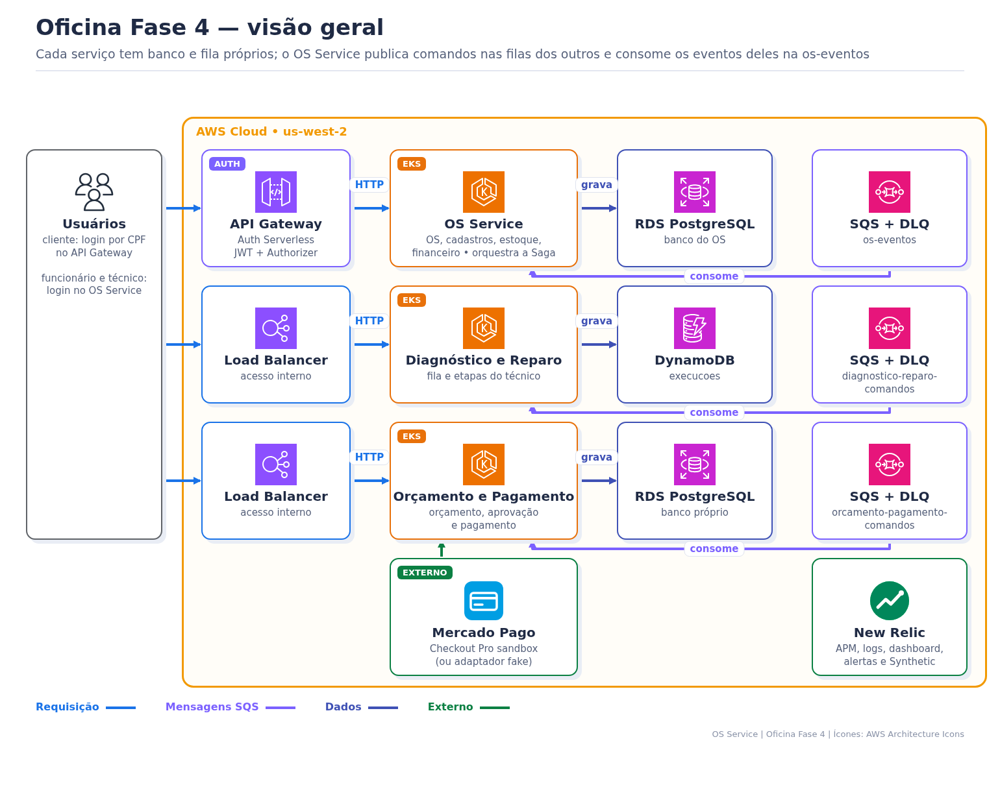

> **Tech Challenge Fase 4 — `fiap-tc-fase4-oficina-os-service`** · documentação central da solução

# Oficina Tech Challenge Fase 4 — documentação central

Este repositório é o ponto de entrada funcional e técnico da Oficina Fase 4. Por ele dá para entender o negócio, a divisão em microsserviços, a Saga, o CI/CD, a subida e a destruição na AWS e as evidências. O detalhe de cada parte fica no README do repositório responsável (seção 3).

- **Atalho conciso para as documentações e atendimento dos requisitos obrigatório do Tech Challenge - fase 4:** [README-requisitos-obrigatorios-fase4.md](README-requisitos-obrigatorios-fase4.md)
- **Índice das documentações e evidências: Tech Challenge - Fase 4** [README-Indice-Evidencia-fase4.md](README-Indice-Evidencia-fase4.md)

## 1. Visão de negócio

A Oficina organiza o atendimento de uma oficina mecânica de ponta a ponta: cadastro do cliente e do veículo, abertura da Ordem de Serviço (OS), diagnóstico, orçamento, aprovação pelo cliente, reparo com baixa de peças, pagamento e entrega. Também apoia o estoque, as notas de fornecedor, o financeiro e os relatórios operacionais.

O sistema atende clientes, atendentes, técnicos e gestores. A **Ordem de Serviço** continua sendo o centro da jornada e guarda o histórico de cada etapa:

```text
RECEBIDA → EM_DIAGNOSTICO → AGUARDANDO_APROVACAO → EM_EXECUCAO → AGUARDANDO_PAGAMENTO → PAGA → ENTREGUE
                                     └─ rejeitado: refaz o diagnóstico ou CANCELADA
```

O histórico de status permite acompanhar o atendimento e calcular indicadores como o volume de OS e o tempo médio por etapa.

- [Visão detalhada de negócio, evolução e engenharia](docs-fase4/visao-negocio-e-engenharia-fase4.md)

## 2. Evolução para a Fase 4

A Fase 3 entregou um backend único com autenticação por CPF no API Gateway, alta disponibilidade no EKS e observabilidade no New Relic. Com o crescimento da operação, esse backend passou a concentrar responsabilidades demais: uma mudança no pagamento, por exemplo, exigia publicar a aplicação inteira.

Na Fase 4, o backend foi dividido em **3 microsserviços**, cada um com banco próprio e pipeline próprio:

- **OS Service:** cliente, veículo, OS, estoque e financeiro, e coordena a jornada da OS (PostgreSQL);
- **Orçamento e Pagamento:** orçamento, aprovação do cliente e pagamento pelo Mercado Pago (PostgreSQL);
- **Diagnóstico e Reparo:** fila e trabalho do técnico (DynamoDB).

Os serviços não acessam o banco uns dos outros. Eles conversam por mensagens SQS, numa **Saga orquestrada** pelo OS Service. Se uma etapa falha, a Saga compensa o que já foi feito e mantém a OS consistente. Autenticação, bancos e Kubernetes continuam em repositórios próprios, como na Fase 3.

## 3. Aplicações da solução

| Componente | Contribuição para o negócio | Responsabilidade técnica | Documentação |
|---|---|---|---|
| OS Service (este) | Conduz o atendimento e a jornada da OS. | Clientes, veículos, OS, catálogo, estoque, notas de fornecedor, financeiro, usuários, relatórios e orquestração da Saga; RDS PostgreSQL. | este README · [Saga](docs-fase4/saga/README.md) |
| Orçamento e Pagamento | Apresenta o orçamento e recebe o pagamento. | Orçamento, aprovação, Mercado Pago Checkout Pro (ou fake) e webhook; RDS PostgreSQL. | [README](https://github.com/tiagomiele/fiap-tc-fase4-oficina-orcamento-pagamento-service#readme) |
| Diagnóstico e Reparo | Organiza o trabalho do técnico. | Fila do técnico, diagnóstico e reparo; DynamoDB. | [README](https://github.com/tiagomiele/fiap-tc-fase4-oficina-diagnostico-reparo-service#readme) |
| Auth Serverless | Permite o acesso seguro do cliente. | Login por CPF, JWT RS256, Lambda Authorizer, API Gateway e notificações; consulta o OS por REST. | [README](https://github.com/tiagomiele/fiap-tc-fase4-oficina-auth-serverless#readme) |
| Database Infra | Preserva os dados e as mensagens da operação. | 2 RDS, 1 tabela DynamoDB, 3 filas SQS com DLQ e telemetria. | [README](https://github.com/tiagomiele/fiap-tc-fase4-oficina-database-infra#readme) |
| Kubernetes Infra | Mantém os serviços disponíveis, escaláveis e observáveis. | VPC, EKS, add-ons e observabilidade New Relic. | [README](https://github.com/tiagomiele/fiap-tc-fase4-oficina-kubernetes-infra#readme) |

## 4. Modelo arquitetural e práticas

- **Microsserviços:** cada serviço tem código, banco, imagem, namespace no EKS e pipeline próprios.
- **Saga orquestrada:** o OS Service envia comandos e recebe eventos pelo SQS, com DLQ, idempotência por `messageId` e compensações.
- **Clean Architecture em 4 anéis** nos 3 serviços (`domain`, `usecase`, `adapter` e `infrastructure`), no estilo de portas e adaptadores, com os limites verificados por ArchUnit.
- **Auth:** camadas leves (`domain`, `application`, `handler`, `infrastructure`), adequadas às Lambdas.
- **Infraestrutura como código:** Terraform no HCP Terraform, com state e workspace por componente e ambiente.
- **Práticas transversais:** DDD, Clean Code, SOLID, testes automatizados, revisão por Pull Request, análise de segurança e observabilidade.

## 5. Arquitetura



A visão macro e a arquitetura interna (portas e adaptadores) de cada serviço estão em [Arquitetura da Fase 4](docs-fase4/arquitetura-fase4.md).

## 6. Padrão Saga Orquestrada

```text
OS ─INICIAR_DIAGNOSTICO─▶ Diagnóstico ─DIAGNOSTICO_CONCLUIDO─▶ OS ─GERAR_ORCAMENTO─▶ Orçamento
OS ◀─ORCAMENTO_APROVADO─ Orçamento    (baixa de estoque; falta peça → CANCELADA e compensação)
OS ─INICIAR_REPARO─▶ Diagnóstico ─REPARO_CONCLUIDO─▶ OS ─SOLICITAR_PAGAMENTO─▶ Pagamento
OS ◀─PAGAMENTO_CONFIRMADO─ Pagamento → PAGA → ENTREGUE
```

**Por que orquestrada:** o fluxo da OS é sequencial e o OS Service já era o dono do status da OS, que virou o estado da Saga. A regra do próximo passo e das compensações fica num lugar só, e os outros serviços só recebem comandos e respondem eventos. Na coreografia, cada serviço teria que conhecer os eventos dos outros e as compensações ficariam espalhadas, o que é mais difícil de testar e rastrear.

Diagramas, comandos, eventos, compensações e **como validar** (logs, filas, DLQ, banco, New Relic e BDD): [docs-fase4/saga/README.md](docs-fase4/saga/README.md). Contrato das mensagens: [docs-fase4/saga/contrato-mensagens.md](docs-fase4/saga/contrato-mensagens.md).

## 7. Tecnologias

| Área | Tecnologias e finalidade |
|---|---|
| Arquitetura | microsserviços, Saga orquestrada, DDD, Clean Architecture, serverless e Infrastructure as Code |
| Aplicação | Java 21, Spring Boot 3.3 (Web, Security, Data JPA, Validation, Actuator) e Flyway |
| APIs e segurança | API Gateway, AWS Lambda, Lambda Authorizer, JWT RS256 (cliente) e JWT interno (funcionário) |
| Dados | Amazon RDS PostgreSQL 16 (OS e Orçamento e Pagamento) e Amazon DynamoDB (Diagnóstico e Reparo) |
| Mensageria | Amazon SQS com DLQ |
| Pagamento | Mercado Pago Checkout Pro (sandbox) e modo fake |
| Plataforma | Amazon EKS, Kubernetes, HPA, PDB e Load Balancer |
| Entrega | GitHub Actions, Docker, GHCR, Terraform, HCP Terraform e GitHub Environments |
| Qualidade | JUnit 5, RestAssured, Testcontainers (LocalStack), ArchUnit, Cucumber (BDD), JaCoCo, Newman, k6 e SonarCloud |
| Segurança de código e IaC | SBOM CycloneDX, Dependency-Track, Trivy, Checkov, TFLint, actionlint, ShellCheck e Gitleaks |
| Observabilidade | New Relic APM, logs JSON com `correlationId`, traces, dashboards, alertas e Synthetic |

## 8. Estrutura de pastas

```text
.
├── .github/workflows/        # CI, BDD, deploy e E2E
├── bdd/                      # BDD da Saga com os 3 serviços e LocalStack
├── docs-fase4/                     # arquitetura, Saga, bootstrap e visão de negócio da Fase 4
├── docs-fase1/ docs-fase2/ docs-fase3/   # documentação das fases anteriores
├── k8s/                      # manifests e scripts de implantação do OS Service
├── scripts/                  # configurar, subir e destruir os ambientes
├── src/main/java/br/com/oficina/
│   ├── domain/               # entidades, regras e exceções de negócio
│   ├── usecase/              # casos de uso, portas e Saga
│   ├── adapter/              # controllers, DTOs, persistência, SQS e integrações
│   └── infrastructure/       # configuração do Spring e composição da aplicação
├── src/main/resources/db/migration/   # migrations Flyway V1–V5
├── src/test/                 # testes unitários, integração e arquitetura
├── tests/postman/            # coleção E2E integrada
├── tests/k6/                 # teste de carga smoke
├── Dockerfile
├── docker-compose.yml
└── pom.xml
```

## 9. API (Swagger)

Swagger UI em `<url-do-serviço>/swagger-ui.html` e OpenAPI em `/v3/api-docs`, com schemas, exemplos e erros. Use **Authorize** com o token de `POST /auth/login`.

| Controller | Quem usa | Exemplos de rotas |
|---|---|---|
| Administrativo | funcionário | `/clientes`, `/veiculos`, `/servicos`, `/pecas`, `/ordens-servico`, `/estoque`, `/notas-fiscais-fornecedor`, `/contas-a-receber`, `/relatorios/*`, `/usuarios` |
| Técnico | técnico | `/ordens-servico/{numeroOs}/servicos`, `/pecas`, `/entregar`, `/cancelar-diagnostico` |
| Cliente | público | `/consulta/ordens-servico/{numeroOs}/status`, `/ordens-servico/{numeroOs}/historico` |
| Auth | todos | `POST /auth/login` |
| Interno | Lambda de login do Auth (chave `X-Api-Key`) | `POST /interno/clientes/autenticacao`: devolve o `idCliente` de um CPF ativo, ou 404 |

### Exemplos de uso

Fluxo principal em PowerShell. `$OS` é a URL do OS Service, `$GW` a do API Gateway e `$AUTH` a do Auth.

```powershell
# 1. Funcionário entra e cadastra cliente, veículo e OS
$adm = Invoke-RestMethod -Method Post "$OS/auth/login" -ContentType 'application/json' -Body '{"email":"admin@oficina.local","senha":"<senha>"}'
$h = @{ Authorization = "Bearer $($adm.accessToken)" }
$cli = Invoke-RestMethod -Method Post "$OS/clientes" -Headers $h -ContentType 'application/json' -Body '{"nome":"Maria","documento":"52998224725","email":"maria@teste.local","telefone":"11999999999"}'
Invoke-RestMethod -Method Post "$OS/veiculos" -Headers $h -ContentType 'application/json' -Body "{`"placa`":`"ABC1D23`",`"marca`":`"Fiat`",`"modelo`":`"Uno`",`"ano`":2020,`"idCliente`":$($cli.idCliente)}"
$os = Invoke-RestMethod -Method Post "$OS/ordens-servico" -Headers $h -ContentType 'application/json' -Body "{`"idCliente`":$($cli.idCliente),`"placa`":`"ABC1D23`",`"descricaoProblema`":`"Barulho no freio`"}"

# 2. Qualquer pessoa consulta o status (público)
Invoke-RestMethod "$OS/consulta/ordens-servico/$($os.numero)/status"

# 3. Depois do diagnóstico, o cliente entra com o CPF, aprova o orçamento e recebe o link de pagamento
$c = Invoke-RestMethod -Method Post "$AUTH/auth/cpf" -ContentType 'application/json' -Body '{"cpf":"52998224725"}'
$hc = @{ Authorization = "Bearer $($c.accessToken)" }
Invoke-RestMethod -Method Post "$GW/orcamentos/$($os.numero)/aprovar" -Headers $hc
(Invoke-RestMethod "$GW/pagamentos/$($os.numero)" -Headers $hc).linkPagamento
```

O fluxo completo, com diagnóstico, reparo, pagamento e entrega, está na [collection Postman](tests/postman/oficina-weeks4-5.postman_collection.json).

Ver os dados gravados (DBeaver/`psql` por túnel, DynamoDB e filas): [Database Infra](https://github.com/tiagomiele/fiap-tc-fase4-oficina-database-infra#readme).

## 10. Executar

### Pré-requisitos

- Java 21;
- Docker e Docker Compose;
- Git;
- acesso à AWS, ao cluster EKS e aos ambientes GitHub somente para implantação remota.

O Maven Wrapper está incluído.

### Executar localmente

```bash
git clone https://github.com/tiagomiele/fiap-tc-fase4-oficina-os-service.git
cd fiap-tc-fase4-oficina-os-service
docker compose up --build          # API, PostgreSQL e Adminer
# ou: docker compose up -d db && ./mvnw spring-boot:run   (Windows: .\mvnw.cmd)
```

API em `http://localhost:8080`, Swagger em `/swagger-ui.html`, health em `/actuator/health` e Adminer em `http://localhost:8081`. As credenciais do `docker-compose.yml` são só para uso local; as variáveis estão em [.env.example](.env.example).

### Testes e validações

```bash
./mvnw -B clean verify spotless:check
```

A suíte inclui testes unitários, integração, persistência, segurança, contrato e arquitetura. O pipeline também executa SBOM, análise de vulnerabilidades e testes funcionais Postman/Newman.

- [Collection Postman integrada](tests/postman/oficina-weeks4-5.postman_collection.json)
- [Ambiente Postman de exemplo](tests/postman/oficina-homolog.postman_environment.example.json)
- [Teste de carga smoke](tests/k6/smoke-load.js)

### Evidência de cobertura de testes

O build falha se a cobertura ficar abaixo de 80% (JaCoCo, `<minimum>0.80</minimum>` no `pom.xml`). Último CI verde em `homolog` (02/11/2026):

| Linhas | Instruções | Branches | Relatório |
|---|---|---|---|
| 84,4% | 83,3% | 71,3% | artefato `jacoco-report` do [run 41484365373](https://github.com/tiagomiele/fiap-tc-fase4-oficina-os-service/actions/runs/41484365373) |

Quality Gate do SonarCloud: [painel do projeto](https://sonarcloud.io/summary/overall?id=tiagomiele_fiap-tc-fase4-oficina-os-service&branch=homolog). Para gerar o relatório local: `./mvnw verify` e abra `target/site/jacoco/index.html`.

### Configuração

Principais variáveis:

| Variável | Finalidade |
|---|---|
| `DB_URL`, `DB_USER`, `DB_PASSWORD` | conexão PostgreSQL |
| `JWT_SECRET` | autenticação interna da equipe |
| `SERVERLESS_JWT_PUBLIC_KEY` | validação dos tokens emitidos pelo Auth |
| `SERVERLESS_JWT_ISSUER`, `SERVERLESS_JWT_AUDIENCE` | validação do emissor e da audiência |
| `AUTH_BASE_URL` | URL do Auth Serverless |
| `NOTIFICATION_ENDPOINT`, `NOTIFICATION_API_KEY` | integração de notificações |
| `OFICINA_ENVIRONMENT` | identificação do ambiente |
| `OFICINA_OBSERVABILITY_NEW_RELIC_ENABLED` | habilitação da integração New Relic |

## 11. CI/CD e implantação

| Workflow | Quando | O que faz |
|---|---|---|
| `ci.yml` | push e PR em `homolog`/`main` | build, testes, cobertura, SBOM, segurança e SonarCloud |
| `bdd.yml` | push e PR em `homolog`/`main` | BDD da Saga com os 3 serviços e LocalStack |
| `cd.yml` → `deploy.yml` | push em `homolog`/`main` | imagem, ConfigMap/Secret e deploy no EKS (`DEPLOY_ENABLED`) |
| `e2e.yml` | push na `homolog` ou manual | aquece as Lambdas e roda a coleção Newman (pagamento fake) |

Fluxo de promoção, igual nos 6 repositórios:

```text
feature → Pull Request → homolog → Pull Request → main
```

- Pull Requests rodam as validações sem implantar;
- `homolog` publica o ambiente de homologação, e `main` publica a produção;
- commits diretos, exclusões e force pushes são bloqueados pelos rulesets;
- a subida completa segue a ordem `Kubernetes → Database → Auth → serviços`.

O passo a passo completo, para quem nunca viu o projeto, está no **[Bootstrap da Fase 4](docs-fase4/bootstrap-aws-do-zero-fase4.md)**: preparação, homologação, produção, validação da Saga, Mercado Pago e, na seção 26, a **destruição da infraestrutura para economizar créditos** (`scripts/destroy-environment.ps1`).

Para operar um ambiente só com scripts e menus (subir, retomar depois do Start Lab, validar, Mercado Pago e destruir), use o **[Bootstrap automatizado](docs-fase4/bootstrap-automatizado-fase4.md)**.

| Script | Para quê |
|---|---|
| `scripts/configure-environment.ps1` | cria e sincroniza workspaces HCP, variáveis e secrets do GitHub |
| `scripts/provision-environment.ps1` | sobe um ambiente inteiro (homolog ou production) de uma vez |
| `scripts/lab-reiniciado.ps1` | depois do Start Lab: renova as credenciais, recupera os nós do EKS e confere os 3 serviços |
| `scripts/validar-ambiente.ps1` | valida o ambiente contra as especificações (health, E2E, k6, BDD e DLQs) e mostra as evidências |
| `scripts/provedor-pagamento.ps1` | liga o Mercado Pago ou volta ao `fake` e aplica no ambiente |
| `scripts/pagamento-mercadopago.ps1` | teste manual do Mercado Pago sandbox, em homolog ou production |
| `scripts/destroy-environment.ps1` | renova as credenciais e destrói um ambiente na ordem certa |
| `scripts/oficina-lab.ps1` | funções comuns aos scripts (menu, credenciais, nós, health e workflows) |

## 12. Documentação e evidências

- [Requisitos obrigatórios da Fase 4](README-requisitos-obrigatorios-fase4.md)
- [Índice das documentações e evidências](README-Indice-Evidencia-fase4.md)
- [Visão de negócio e engenharia](docs-fase4/visao-negocio-e-engenharia-fase4.md)
- [Saga: comandos, eventos, compensações e validação](docs-fase4/saga/README.md)
- [Bootstrap detalhado da Fase 4](docs-fase4/bootstrap-aws-do-zero-fase4.md)

## 13. Projetos relacionados e histórico

- [Orçamento e Pagamento](https://github.com/tiagomiele/fiap-tc-fase4-oficina-orcamento-pagamento-service)
- [Diagnóstico e Reparo](https://github.com/tiagomiele/fiap-tc-fase4-oficina-diagnostico-reparo-service)
- [Auth Serverless](https://github.com/tiagomiele/fiap-tc-fase4-oficina-auth-serverless)
- [Database Infra](https://github.com/tiagomiele/fiap-tc-fase4-oficina-database-infra)
- [Kubernetes Infra](https://github.com/tiagomiele/fiap-tc-fase4-oficina-kubernetes-infra)
- Fases anteriores: [Fase 1](docs-fase1), [Fase 2](docs-fase2), [Fase 3](docs-fase3), [requisitos da Fase 3](docs-fase3/README-requisitos-obrigatorios-fase3.md), [índice de evidências da Fase 3](docs-fase3/README-Indice-Evidencia-fase3.md) e [projeto original da Fase 3](https://github.com/tiagomiele/fiap-tech-challenge-fase3-oficina-backend)

## Licença

Consulte o arquivo [LICENSE](LICENSE).
