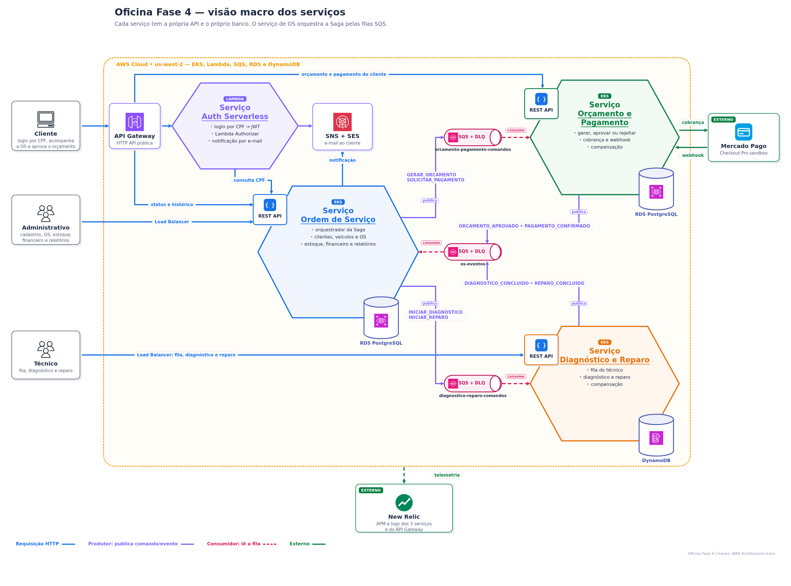
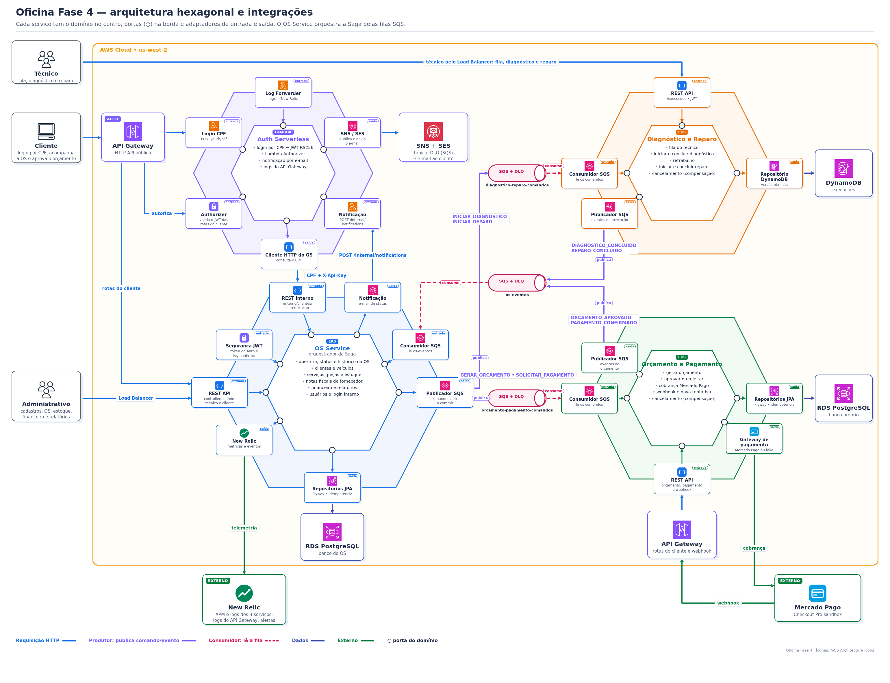

# Arquitetura da Fase 4

Voltar para a [documentação central](../README.md).

## 1. Visão macro



- O cliente entra pelo **API Gateway**. O Lambda Authorizer valida o JWT do Auth antes de chegar aos serviços.
- Os funcionários usam a API do OS Service com o JWT interno.
- Cada serviço tem o **próprio banco**: PostgreSQL no OS e no Orçamento e Pagamento, DynamoDB no Diagnóstico e Reparo.
- Entre os serviços só passam **mensagens SQS**. Nenhum serviço lê o banco de outro.
- O Orçamento e Pagamento integra com o **Mercado Pago**, e todos enviam telemetria ao **New Relic**.

## 2. Arquitetura interna dos serviços



Os 3 serviços seguem Clean Architecture em 4 anéis, no estilo de portas e adaptadores:

```text
infrastructure → adapter → usecase → domain
```

- **domain:** entidades e regras de negócio em Java puro;
- **usecase:** casos de uso e portas (repositório, mensageria e integrações);
- **adapter:** REST, persistência, SQS, segurança e Mercado Pago;
- **infrastructure:** configuração do Spring.

Trocar o banco ou a fila muda só o adaptador. Os testes ArchUnit garantem que o domínio não depende dos frameworks.

## 3. Saga

Os diagramas da Saga ficam em [docs/saga/README.md](saga/README.md).
